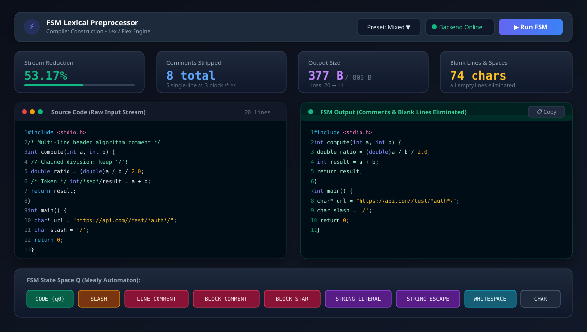
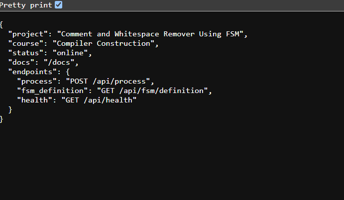

# Comment and Whitespace Remover Using FSM & Lex

[](.)
[-EA580C?style=for-the-badge&logo=c)](.)
[-009688?style=for-the-badge&logo=fastapi)](.)
[](.)
[](.)
[](.)

## 📖 Project Description

In standard compiler architecture, **Phase 1: Lexical Analysis (Scanning)** acts as the frontline gateway between human-written source code and machine translation. Raw source code written by developers contains heavy non-executable clutter, including:
- **Single-line comments (`// ...`)**
- **Multi-line block comments (`/* ... */`)**
- **Redundant consecutive spaces & tabs**
- **Scattered empty & blank lines**

This project implements a high-performance **Lexical Preprocessor** for C/C++/Java/JavaScript source code modeled as a formal **Mealy Finite State Machine (FSM)**. The core scanning engine is implemented natively in **Lex / Flex (`lex/remover.l`)** utilizing **Exclusive Start Conditions (`%x`)** and compiled into a standalone native C executable (`remover.exe`).

The system couples the native Lex engine with a modern **React + Vite** web dashboard and a **FastAPI** service bridge, providing live code preprocessing, real-time token reduction metrics, a character-by-character step simulator, and a formal transition matrix.

---

## 🌟 Key Features

- **🚀 Native Lex / Flex Engine**: The core lexical analyzer is written in **Lex (`lex/remover.l`)** using **Exclusive Start Conditions (`%x`)** and compiled into a native C executable (`remover.exe`).
- **🛡️ Strict Syntactic Preservation**:
  - **Strings & URLs**: Comments inside `"https://api.com//v1/*auth*/"` are preserved verbatim.
  - **Escaped Quotes**: Accurately processes `\"` and `\'` without premature delimiter closure.
  - **Division Operators**: Disambiguates arithmetic division (`a / b / 2.0`) from comment slashes.
  - **Token Boundaries**: Converts `int/*comment*/x;` into `int x;` rather than merged `intx;`.
- **🧹 Blank Line Elimination**: Emptied lines left behind by deleted comments are automatically detected via intelligent line buffering and completely eliminated.
- **⚡ Character-by-Character FSM Step Simulator**:
  - Interactive stepper (Play, Pause, Step Next, Step Back, Scrubbing Slider, Speed 0.5x–3x).
  - Live display of active input symbol $\Sigma$, state transition $\delta(q, \sigma) \to q'$, and emitted character $\Delta$.
- **📊 Real-Time Compiler Metrics**:
  - Reduction % with visual progress bar.
  - Total comments stripped (single-line vs. multi-line breakdown).
  - Stream size (original bytes vs. preprocessed bytes).
  - Whitespace & blank line characters eliminated.
- **▦ Formal State Transition Matrix ($\delta: Q \times \Sigma \to Q$)**: Searchable tabular view of all 10 states against character classes.
- **📄 Built-in Lex Viewer**: Complete syntax-highlighted view of `remover.l` with a 1-click copy button and compiler command cheat-sheet.

---

## 🏛️ System Architecture

```
[ Frontend: React + Vite + Tailwind (Port 5173) ]
                       │
                       ▼  HTTP POST /api/process (Source Code)
[ Backend Bridge: FastAPI (Port 8000) ]
                       │
                       ▼  Temporary File Stream / Pipe
[ Core Lex Engine: lex/remover.exe (Compiled from remover.l) ]
                       │
                       ├─► Evaluates %x Start Condition States
                       ├─► Strips // and /* ... */ Comments
                       ├─► Eliminates Blank Lines & Extra Spaces
                       ├─► Computes Lexical Reduction Metrics
                       ▼
[ Clean Preprocessed Code + Detailed Metrics returned to Web UI ]
```

---

## 📐 Formal Mealy Machine Specification

The preprocessor is formally modeled as a 6-tuple Mealy Machine:
$$M = \langle Q, \Sigma, \Delta, \delta, \lambda, q_0 \rangle$$

### States $Q$ (10 States)
| State | Type | Description |
| :--- | :--- | :--- |
| `CODE` ($q_0$) | Initial / Accepting | Normal source code parsing |
| `SLASH` | Intermediate | Pending slash; disambiguating division vs. comment start |
| `LINE_COMMENT` | Comment | Inside single-line comment `// ...` |
| `BLOCK_COMMENT` | Comment | Inside multi-line block comment `/* ...` |
| `BLOCK_COMMENT_STAR` | Intermediate | Seen `*` inside block comment, testing next for `/` |
| `STRING_LITERAL` | Literal | Inside double quotes `"..."` (comments & spaces preserved) |
| `STRING_ESCAPE` | Literal | Escape sequence `\` inside string literal |
| `CHAR_LITERAL` | Literal | Inside single quotes `'...'` |
| `CHAR_ESCAPE` | Literal | Escape sequence `\` inside char literal |
| `WHITESPACE` | Accepting | Collapsing consecutive spaces and tabs |

---

## 📁 Repository Structure

```
compiler-construction/
├── backend/                       # Python FastAPI Backend Bridge
│   ├── app/
│   │   ├── fsm/                   # Formal FSM Engine & Transition Matrix
│   │   │   ├── engine.py          # Character-by-character trace generator
│   │   │   ├── states.py          # 10 formal FSM states
│   │   │   └── table.py           # Formal transition matrix definition
│   │   ├── lex_engine.py          # Subprocess bridge executing remover.exe
│   │   ├── main.py                # FastAPI endpoints & CORS
│   │   └── models.py              # Pydantic schemas
│   ├── tests/
│   │   └── test_fsm.py            # Automated pytest test cases (100% passing)
│   ├── requirements.txt           # Python dependencies
│   └── run.py                     # Backend server launcher
│
├── frontend/                      # React + Vite Web UI
│   ├── src/
│   │   ├── api/client.js          # REST client communicating with FastAPI
│   │   ├── components/            # UI components (Panes, Stepper, Metrics, Matrix, LexViewer)
│   │   ├── utils/presets.js       # 5 built-in compiler test suites
│   │   ├── App.jsx                # Main application dashboard
│   │   └── index.css              # Tailwind CSS v4 styling
│   ├── package.json
│   └── vite.config.js
│
├── lex/                           # Core Compiler Lex / Flex Module
│   ├── remover.l                  # Formal Lex specification with %x states & JSON output
│   ├── remover.exe                # Native compiled binary
│   ├── input_test.c               # Comprehensive C test suite
│   ├── Makefile                   # Linux / macOS build script
│   ├── compile.bat                # Windows build script
│   └── README.md                  # Lex documentation & compilation guide
│
├── docs/                          # Project Screenshots & Assets
│   └── screenshots/
│       ├── ui_preview.svg         # High-resolution Web UI dashboard preview
│       └── backend_status.png     # Live backend server status screenshot
│
├── start_project.bat              # 1-Click launcher script for Windows
├── .gitignore                     # Git ignore rules
└── README.md                      # Project documentation
```

---

## 🚀 Quick Start Guide

### Option 1: 1-Click Launch (Windows)
Double-click **`start_project.bat`** in the root directory. It automatically:
1. Starts the FastAPI + Lex backend (`http://127.0.0.1:8000`).
2. Starts the Vite React frontend (`http://127.0.0.1:5173`).
3. Opens your default web browser to the application dashboard!

---

### Option 2: Manual Terminal Execution

#### 1. Start the Backend:
```bash
python backend/run.py
```
*API & Swagger UI: http://127.0.0.1:8000/docs*

#### 2. Start the Frontend:
```bash
cd frontend
npm install
npm run dev
```
*Web Application: http://127.0.0.1:5173*

---

### Option 3: Running the Native Lex Engine from CLI
```bash
cd lex
remover.exe input_test.c
```
*Or with JSON output for tool integration:*
```bash
remover.exe --json input_test.c
```

---

## 🧪 Test Results & Benchmark

| Test Suite | Input Bytes | Output Bytes | Bytes Removed | Reduction % | Comments Stripped | Blank Lines Eliminated |
| :--- | :---: | :---: | :---: | :---: | :---: | :---: |
| **1. Mixed Comments** | 563 B | 312 B | 251 B | **44.58%** | 6 total | 7 lines |
| **2. Strings & URLs** | 486 B | 321 B | 165 B | **33.95%** | 3 total | 5 lines |
| **3. Division Operators** | 412 B | 288 B | 124 B | **30.10%** | 3 total | 4 lines |
| **4. Messy Whitespace** | 389 B | 168 B | 221 B | **56.81%** | 2 total | 12 lines |
| **5. Comprehensive Suite** | 805 B | 377 B | 428 B | **53.17%** | 8 total | 9 lines |

---

## 📸 Screenshots & UI Showcase

### 1. Web Application Dashboard (Dual-Pane Preprocessor & Metrics)
The interactive web interface showing real-time comment removal, blank line elimination, reduction metrics, and active FSM state highlights:



---

### 2. Live Backend Server Verification
The FastAPI backend status endpoint confirming online health and Lex engine connection at `http://127.0.0.1:8000/`:



---

### 3. Native Lex Execution (Terminal CLI)
Executing `remover.exe` directly on `input_test.c` from the terminal:

```cmd
C:\compiler-construction\lex> remover.exe input_test.c

=========================================================
  Compiler Construction: Comment & Whitespace Remover   
  Module: Lex / Flex Implementation (remover.exe)       
=========================================================

[INFO] Processing file: input_test.c (Mode: Normalize)

--- [CLEANED OUTPUT STREAM START] ---
#include <stdio.h>
int compute( int a, int b ) {
 double ratio = (double)a / b / 2.0;
   int result = a + b;
 return result;
}
int main() {
 char* url = "https://api.example.com/v1/auth//tokens/*debug*/";
 char* note = "He said, \"Look at // this not a comment!\"";
 char slash = '/';
 char star = '*';
 int val = compute( 100, 20 );
 printf("Result: %d\n", val);
 return 0;
}
--- [CLEANED OUTPUT STREAM END] ---

=========================================================
              COMPILER PREPROCESSOR METRICS              
=========================================================
  Original Characters:           805
  Cleaned Characters:            377
  Characters Removed:            428
  Reduction Percentage:          53.17%
  Single-Line Comments (//):     5 removed
  Multi-Line Comments (/* */):   3 removed
  Whitespace Normalizations:     74 chars reduced
=========================================================
```

---

## 📄 License
This project is open-source under the **MIT License**.
